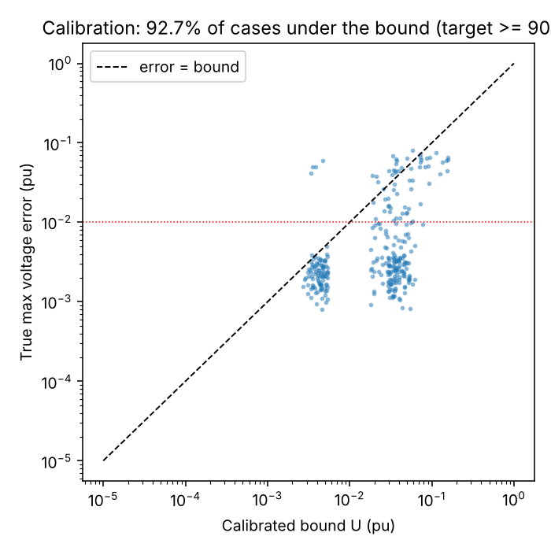
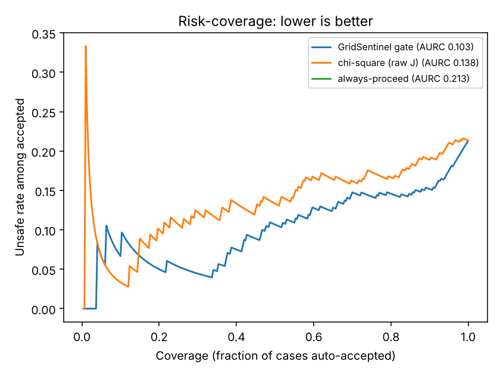
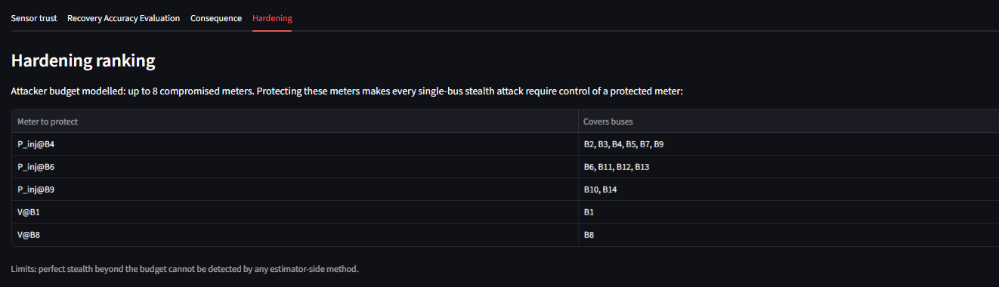

<p align="center"></p>

<p align="center">
<a href="https://colab.research.google.com/drive/1Ky0RoWwjTxTo0-KPsxPeu0HLbJhAMpJQ?usp=sharing"></a>
&nbsp;<b>Website:</b> <a href="WEBSITE_URL_HERE">WEBSITE_URL_HERE</a>
</p>

**A self-protecting state estimator for smart grids: it detects false data injection attacks, isolates compromised meters, recovers the grid state, and tells the operator how far to trust the result.**

SAIF 2026 · Cybersecurity track · Najran University team

---

## The problem
Grid operators make decisions (voltage control, dispatch, load shedding) from sensor data. A false data injection attack (FDIA) can corrupt that data so the control room sees a healthy grid while it is not. Most detectors raise an alarm and stop there, and carefully crafted *stealth* attacks leave no alarm at all. The operator still cannot tell how far off the cleaned picture could be.

## What GridSentinel does
1. **Estimate** the grid state from 122 AC measurements (voltage, power injections, line flows) with weighted least squares and a robust Huber estimator.
2. **Score trust** in every meter and every sensor station (S01-S14) from the measurements alone, with no reference to true values.
3. **Isolate** suspicious meters one at a time, guarded so the grid stays observable.
4. **Recover** the state from the trusted meters.
5. **Trust Gate:** a calibrated, conformal-prediction gate gives an error bound with a 90% target and returns one of **PROCEED / CAUTION / VALIDATE**.
6. **Recovery Accuracy Evaluation:** a table of true vs attacked vs reconstructed voltage. True values are used for scoring only, never in a live decision.

## Results (simulation, IEEE 14-bus, seed 7, 300 scenarios per split)
| Metric | Value |
|---|---|
| Calibrated error bound holds on held-out test (target ≥ 90%) | **92.7%** |
| Unsafe results auto-accepted (all cases) | **1.3%** vs 21.3% for always-proceed |
| Risk-coverage AURC (lower is better) | **0.103** vs 0.138 chi-square vs 0.213 always-proceed |
| Large single-meter attack isolation (recall / precision) | **100% / 100%** |
| Runtime per snapshot | **7 ms** median |

Five grids, same pipeline ([`docs/EXPERIMENTS.md`](docs/EXPERIMENTS.md)):

| Grid | Bound coverage (target 90%) | Unsafe after PROCEED | False alarm on clean data | Median error before → after (pu) |
|---|---|---|---|---|
| IEEE 14 | 90.7% | 4.4% | 2.3% | 0.0063 → 0.0032 |
| IEEE 30 | 91.8% | 4.1% | 3.7% | 0.0067 → 0.0046 |
| IEEE 57 | 90.9% | 3.8% | 7.1% | 0.0063 → 0.0053 |
| IEEE 118 | 89.5% | 5.6% | 17.2% | 0.0030 → 0.0024 |
| ACTIVSg200 (validation-tuned) | 90.6% | 11.6% (at 0.03 pu) | about 6% | 0.0071 → 0.0065 |

ACTIVSg200 is a synthetic but realistic 200-bus Texas-style grid from Texas A&M (not utility data). The algorithm is described step by step in [`docs/ALGORITHM.md`](docs/ALGORITHM.md).




## Bring your own grid (MVP tool)
Give GridSentinel a standard grid file (MATPOWER `.m`, or `case14/30/57/118`) and a CSV of meter readings. It returns PROCEED / CAUTION / VALIDATE, a calibrated error bound and the isolated meters for every snapshot.
```bash
pip install matpowercaseframes                       # only needed for your own .m grid files
streamlit run gridsentinel_byog_app.py               # interface: pick a grid, build the gate, load readings
python gridsentinel_cli.py template  --grid case14 --out meas.csv
python gridsentinel_cli.py calibrate --grid case14 --cal cal.json
python gridsentinel_cli.py run       --grid case14 --meas meas.csv --cal cal.json --out decisions.csv
```
Units: V in per unit, P in MW, Q in MVAr (injections positive = generation). Details: [`docs/MVP_TOOL.md`](docs/MVP_TOOL.md).

## Roadmap
- **Pilot on real utility data** (offline replay of historical measurements).
- **Physics + learned hybrid gate:** early IEEE 14 test raised PROCEED from 35% to 69% and cut unsafe accepts from 4.5% to 1.3% ([`docs/HYBRID.md`](docs/HYBRID.md)).
- **Automatic per-grid tuning** for large grids (on ACTIVSg200, tuning cut false alarms from 23% to about 6%).
- **Stronger defence against very small coordinated attacks;** time dynamics and topology errors; faster solvers for national-scale grids.

All results come from simulation on pandapower benchmark grids with synthetic attacks; the error bound holds for scenarios from the same generator. Robustness and stress tests are in [`docs/ROBUSTNESS.md`](docs/ROBUSTNESS.md).

## Quick start
```bash
pip install -r requirements.txt
python batch_eval.py --n 300 --seed 7 --out results   # ~2 min, reproduces the IEEE 14 numbers
streamlit run gridsentinel_app.py                       # live operator demo
python -m pytest -q test_gridsentinel.py                # tests
python multi_grid_eval.py --cases case14 case30 --quick --out results_test   # ~1 min smoke test
```
**Google Colab:** click the badge above, then Runtime → Run all. The notebook prints public links to the demo and to the bring-your-own-grid interface.

## Demo guide
In the **Operator panel** choose a seed, tick *Fixed seed* for repeatability, and pick a scenario: none, random single, multi, stealth (partial), adaptive attacker, or custom. Read the **Attack status** banner, then the **Trust Gate** verdict, then open **Recovery Accuracy Evaluation** for the before/after table.
| | |
|:--:|:--:|
|  |  |
| *Operator panel* | *Attack status banner* |
|  |  |
| *Trust Gate + Recovery Accuracy* | *Hardening view* |


*Full GridSentinel AI interface*

## Repository layout
| File | Purpose |
|---|---|
| `gridsentinel_core.py` | AC measurement model, attacks, live pipeline, Trust Gate, evaluation helpers |
| `gridsentinel_app.py` | Streamlit operator demo |
| `gridsentinel_byog_app.py`, `gridsentinel_cli.py` | Bring-your-own-grid interface and command-line tool |
| `batch_eval.py`, `multi_grid_eval.py` | Reproducible evaluation (IEEE 14) and multi-grid, multi-seed evaluation |
| `robustness_eval.py`, `worstcase_calibration_eval.py`, `stealth_magnitude_sweep.py` | Stress tests |
| `hybrid_gate.py`, `hybrid_gate_eval.py` | Physics + learned hybrid gate experiment |
| `activsg_eval.py`, `activsg_pool.py`, `activsg_tune.py`, `activsg_ziso.py`, `case_ACTIVSg200.m` | 200-bus grid evaluation and per-grid tuning |
| `test_gridsentinel.py` | Correctness tests (Jacobian, no truth leak, stealth limit, reproducibility) |
| `GridSentinel_Colab.ipynb` | Self-contained Colab notebook |
| `docs/` | Algorithm, experiments, robustness, hybrid, MVP tool |
| `results*/` | Measured outputs and plots |

## Tech stack
Python · pandapower 3.5.6 · NumPy / SciPy / pandas · scikit-learn · Streamlit

## Team
| | LinkedIn |
|---|---|
| Maryam Fagbo | [maryam-fagbo](https://www.linkedin.com/in/maryam-fagbo-769b20328/) |
| Fatima Al Khuraym | [fatima-al-khuraym](https://www.linkedin.com/in/fatima-al-khuraym-b79aa6387) |
| Majd Alshehri | [majd-alshehri](https://www.linkedin.com/in/majd-alshehri-a0590737a) |
| Salwa Hussain | [salwa-hussain](https://www.linkedin.com/in/salwa-hussain-b4a015254) |
| Ghala Mohammed | [ghala-mohammed](https://www.linkedin.com/in/ghala-mohammed-2687ab419) |

Najran University · SAIF 2026
