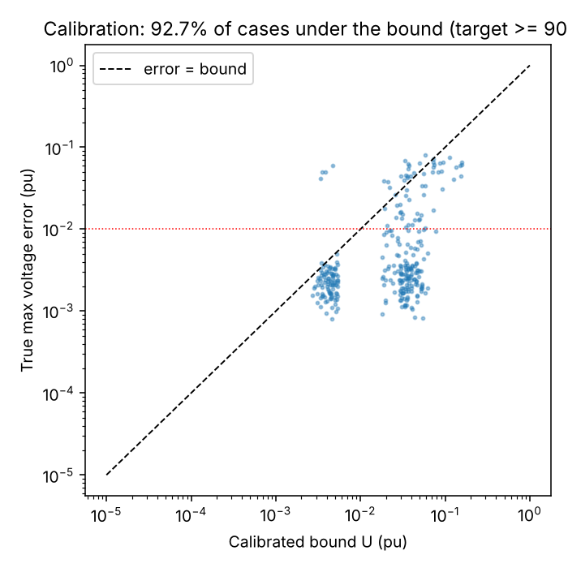
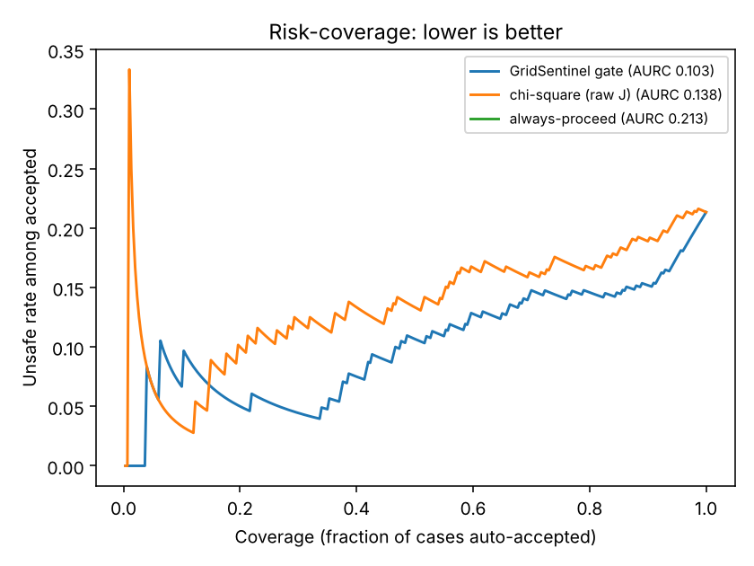

# ⚡ GridSentinel AI

**A self-protecting state estimator for smart grids: it detects false data injection attacks, isolates compromised meters, recovers the grid state, and tells the operator when *not* to trust the result.**

SAIF 2026 · Cybersecurity track · Najran University team

---

## The problem
Grid operators make decisions (voltage control, dispatch, load shedding) from sensor data. A false data injection attack (FDIA) can corrupt that data so the control room sees a healthy grid while it is not. Most detectors raise an alarm and stop there. Worse, carefully crafted *stealth* attacks leave no alarm at all.

## What GridSentinel does
1. **Estimate** the grid state from 122 AC measurements (voltage, power injections, line flows) with weighted least squares and a robust Huber estimator.
2. **Score trust** in every meter and every sensor station (S01-S14) from the measurements alone, with no reference to true values.
3. **Isolate** suspicious meters one at a time, guarded so the grid stays observable.
4. **Recover** the state from the trusted meters.
5. **Trust Gate:** a calibrated, conformal-prediction gate gives an error bound with a target risk of 10%, and returns one of **PROCEED / CAUTION / VALIDATE**. When the evidence is not strong enough, it refuses to be confident.
6. **Recovery Accuracy Evaluation:** a table of true vs attacked vs reconstructed voltage with reconstruction error. The true voltage is used for scoring only and never in a live decision.

## Results (simulation, IEEE 14-bus, seed 7, 300 scenarios per split)
| Metric | Value |
|---|---|
| Calibrated error bound holds on held-out test (target ≥ 90%) | **92.7%** |
| Unsafe results auto-accepted (all cases) | **1.3%** vs 21.3% for always-proceed |
| Risk-coverage AURC (lower is better) | **0.103** vs 0.138 chi-square vs 0.213 always-proceed |
| Large single-meter attack isolation (recall / precision) | **100% / 100%** |
| Runtime per snapshot | **7 ms** median |

Full tables, ablations and plots: [`results/results_summary.md`](results/results_summary.md).




## Honest limits
- Perfect stealth attacks (attacker controls far more meters than the modelled budget of 8) leave every residual unchanged. No estimator-side method can detect them. The guarantee holds inside the stated attacker budget.
- Partial-stealth and adaptive attacks are mostly not recoverable; the gate sends them to operator review instead of guessing.
- Simulation on one network (IEEE 14-bus), load range ±20%. Results are reproducible with the scripts below.

## Quick start
```bash
pip install -r requirements.txt
python batch_eval.py --n 300 --seed 7 --out results   # ~2 min, reproduces the numbers above
streamlit run gridsentinel_app.py                       # live demo
python -m pytest -q test_gridsentinel.py                # tests
```
**Google Colab:** open `GridSentinel_Colab_selfcontained.ipynb`, then Runtime → Run all. The last cell prints a public link to the demo.

https://colab.research.google.com/drive/1pyrGRElP25TlEZZ6eIHSskiGBcTLCu_1?usp=sharing

## Demo guide
In the **Operator panel** choose a seed, tick *Fixed seed* for repeatability, and pick a scenario: none, random single, multi, stealth (partial), adaptive attacker, or custom. Read the **Attack status** banner, then the **Trust Gate** verdict, then open **Recovery Accuracy Evaluation** for the before/after table.

## Repository layout
| File | Purpose |
|---|---|
| `gridsentinel_core.py` | AC measurement model, attacks, live pipeline, Trust Gate, evaluation helpers |
| `gridsentinel_app.py` | Streamlit demo |
| `batch_eval.py` | Reproducible evaluation: baselines, ablations, calibration, risk-coverage |
| `test_gridsentinel.py` | Correctness tests (Jacobian, no truth leak, stealth limit, reproducibility) |
| `gate_calibration.json` | Pre-fitted gate so the demo starts instantly |
| `results/` | Measured outputs and plots |

## Tech stack
Python · pandapower 3.5.6 · NumPy / SciPy / pandas · scikit-learn · Streamlit

## Team
Maryam Fagbo and team, Najran University.
